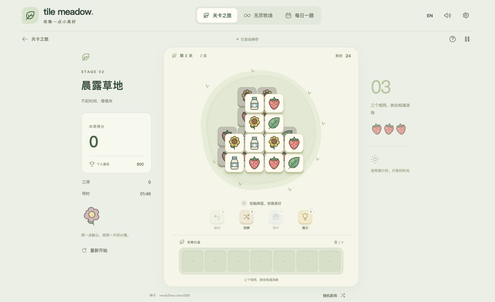
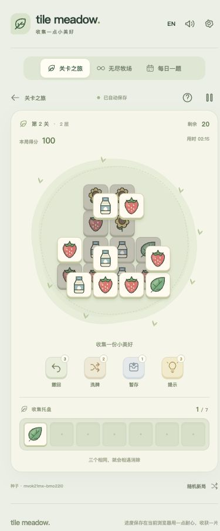

# Tile Meadow · 牧场三消

A small meadow, a little strategy, and seven slots. 牧场三消是一款独立原创的层叠三消浏览器游戏：找出可以拾取的图案，凑齐三个相同图案，逐层清空牧场。

**Play:** [user-dhw.github.io/Tile-Meadow](https://user-dhw.github.io/Tile-Meadow/) · **Source:** [user-dhw/Tile-Meadow](https://github.com/user-dhw/Tile-Meadow)

Built with React 19, strict TypeScript, Vite, native SVG/CSS, Vitest, LocalStorage and the Web Audio API. No backend, account, API key, advertising or payment is required.

## Features

- Real overlapping tile geometry, consistent visual stacking and blocked-tile selection rules.
- Seeded procedural puzzles with a verified complete winning sequence for every generated board.
- Gradual stage progression, endless challenges and a shared UTC daily puzzle.
- Exactly seven collection slots, automatic triple matching, combos and completion scoring.
- Undo, safe shuffle, temporary storage for three tiles and hints.
- Automatic local saves, level unlocks, personal records and settings.
- Simplified Chinese by default, with a persistent English option.
- Original illustrated SVG symbols and optional synthesized sound effects.
- Responsive controls, keyboard-operable buttons, safe-area support and reduced-motion styling.
- GitHub Actions linting, tests, production builds and GitHub Pages deployment.

## Screenshots

The game uses a mint and cream meadow theme with original vector illustrations. These screenshots were captured from actual gameplay during browser verification.





## Rules

1. Select an uncovered tile. Any positive overlap from a higher tile blocks selection, including a partially covered tile.
2. A selected tile moves into the seven-slot collection tray. Identical symbols are grouped together.
3. Three identical symbols disappear automatically. A triple is resolved **before** checking tray capacity, including a match made by the seventh inserted tile.
4. Seven occupied slots after matching ends the run. An eighth tile cannot be inserted.
5. Win by clearing the board, tray **and** temporary holding area. There is no countdown.
6. Restart replays the current seed. A new challenge uses a new seed; normal restarting keeps existing achievements.

## Game modes

| Mode | How it works |
| --- | --- |
| Level challenge | Complete the tutorial and successive stages to unlock the next level. Completed stages can be replayed. |
| Endless | Continue through progressively harder puzzles. Consecutive wins, cumulative score and best streak are stored locally. |
| Daily challenge | Everyone on the same application version receives the same puzzle for a UTC calendar date. Replay is allowed and completion is saved on this browser. |

Daily seeds use `daily:YYYY-MM-DD`, calculated with UTC rather than the device's local date. This is a local game; scores and completion do not synchronize across devices and there are no global rankings.

## Tools and scoring

| Tool | Behavior |
| --- | --- |
| Undo | Restore the board, tray, held tiles and score before the last selection, including a triple removed by that move. A spent undo charge stays spent. |
| Shuffle | Reassign only remaining board symbols while preserving geometry, symbol quantities and the tray. A proposed winning continuation must pass engine replay; otherwise the charge is kept. |
| Hold three | Move up to three tray tiles into temporary storage. Select held tiles to return them to the tray under the usual capacity and matching rules. They still count toward victory. |
| Hint | Prefer a verified winning continuation. If the bounded solver cannot prove one, show a legal suggestion with an explicit limitation. |

Default charges per puzzle are 3 undo, 2 shuffle, 1 hold and 3 hint. Tool actions that change the board/tray clear incompatible undo history.

A triple earns **100 points**. Consecutive matching turns earn an additional **20 × (combo − 1)** points. Completing the puzzle adds **500 points**. The interface tracks moves, matches, combo, elapsed active time, score and tools consumed.

## How solvability is guaranteed

The generator constructs a solution instead of hoping a random symbol assignment will be playable:

1. A seeded pseudo-random generator selects a spatial template and layer offsets. Templates use diamond, rounded rectangle, cross or paired-tower cell rankings; the tutorial uses a simple single layer.
2. The generator repeatedly asks the actual geometry engine for selectable tiles and records a randomized legal removal order.
3. Symbols are assigned along that order in complete groups of three. Harder stages interleave several groups within a bounded window, while never requiring more than six unresolved tray tiles between matches.
4. The validator checks coordinates, tile identities, symbol multiples, initial legal moves and layer blocking. It then replays the entire stored witness through the same turn functions as live gameplay.
5. Generation retries at most three candidates. A deterministic fallback assigns consecutive triples to a legal removal order and is validated again before use.

This certificate guarantees **at least one winning route from a fresh board**. It does not guarantee every choice will remain solvable. Hints first replay the remaining certificate and then use a search with a fixed node budget. A legal-only hint never claims to guarantee victory.

Rendering uses the same 7 × 7 logical coordinates and 1 × 1 tile rectangles as overlap detection and validation. Removing a tile changes its removal state without moving other tiles. React stacking follows layer and tile order.

## Project structure

```text
.github/workflows/deploy.yml  # lint → tests → build → Pages
public/                      # original favicon and verification screenshots
src/
  components/                # game screens, board, SVG symbols and icons
  config/                    # central level, scoring and power configuration
  engine/                    # pure deterministic rules, geometry, generation and solver
  hooks/                     # React orchestration and synthesized audio
  i18n/                      # Chinese and English dictionaries
  styles/                    # responsive presentation and animations
  tests/                     # engine, generation and persistence tests
  utils/storage.ts           # versioned saves, progression and UTC daily seeds
```

## Development

Use Node.js **22 LTS** and npm. Node.js 20.19+ also supports the selected Vite toolchain.

```sh
git clone https://github.com/user-dhw/Tile-Meadow.git
cd Tile-Meadow
npm ci
npm run dev
```

The dev server prints its local address, normally `http://127.0.0.1:5173/`.

```sh
npm run lint       # ESLint and React hook checks
npm test           # Vitest once, including many generated seeds
npm run build      # strict TypeScript and production Vite bundle
npm run preview    # preview dist locally
```

To test the production repository subpath locally:

```sh
PAGES_BASE_PATH=/Tile-Meadow/ npm run build
npm run preview
```

Open the preview address followed by `/Tile-Meadow/`. No environment variables are needed for normal local development.

## Tests

Release verification: **116 tests passed**, strict TypeScript/production build and ESLint passed. Generated-puzzle tests replay 144 seeds across levels 1–18, plus additional mixed-power and high-level audits. Browser checks cover tutorial completion, next-level unlock, triple undo, pocket/return, shuffle, hints, save/reload, seven-slot loss and recovery, persistent English settings and deterministic UTC daily restarts. Responsive checks cover 1280×720, 390×844, 320×568 and 844×390; no horizontal overflow and the collection tray remains visible. Physical iOS/Android devices have not been tested.

The test suite covers legal/blocked/partial-overlap selection, multiple blockers, unlocking, deterministic tray grouping, seventh-slot matches, loss and capacity, duplicate input, win conditions including held tiles, undo after matches, power-up consumption, shuffle count preservation, holding/returning tiles, score, deterministic randomness and progressive configuration.

Generator tests validate many seeds across difficulty levels, replay each witness using live turn rules, reject illegal selections and verify the final win without tray overflow. Persistence tests exercise real generated runs at several levels, LocalStorage restoration, corrupted data, schema versions, disabled/quota-limited storage, achievements and UTC daily dates.

## GitHub Pages

The workflow at `.github/workflows/deploy.yml` runs on pushes to `main` and manual dispatch. It uses official GitHub Pages actions, Node.js 22, `npm ci`, lint, tests and a production build with `PAGES_BASE_PATH=/Tile-Meadow/`. Only a successful build is uploaded and deployed to the `github-pages` environment.

For a fresh fork:

1. Set **Settings → Pages → Build and deployment → Source → GitHub Actions**.
2. If the repository name changes, update `PAGES_BASE_PATH` in the workflow to `/<your-repository-name>/`.
3. Push to `main` or run **Actions → Test and deploy Tile Meadow → Run workflow**.
4. Wait for both `build` and `deploy` jobs to succeed, then open the URL in the deployment summary.

The workflow requests `contents: read`, `pages: write` and `id-token: write`. It contains no repository secrets. Configuration follows the official [Vite static deployment guide](https://vite.dev/guide/static-deploy.html#github-pages) and [GitHub Pages custom workflow documentation](https://docs.github.com/en/pages/getting-started-with-github-pages/using-custom-workflows-with-github-pages).

## Customization

- **Add symbols:** extend `SYMBOLS` in `src/engine/types.ts`, add matching original SVG artwork in `src/components/Symbol.tsx`, and add a name to both translation dictionaries. Increase level symbol limits only after adding symbols.
- **Add levels / change difficulty:** edit the central progression table and scaling in `src/config/levels.ts`. Counts must be divisible by three; keep templates within the board bounds. Re-run generation tests across many seeds.
- **Change layout generation:** edit `generateLayeredLayout` in `src/engine/levelGenerator.ts`. Keep same-layer tiles separate, use stable IDs and run `validateGeneratedLevel` plus witness replay.
- **Change colors:** update the design variables and styles in `src/styles/global.css`.
- **Change tool counts / scoring:** edit `src/config/gameConfig.ts` and scoring functions. Add new tools as engine actions before wiring interface controls, with deterministic transitions and tests.
- **Add languages:** extend the translation dictionaries and persistent language settings together.

## Persistence and compatibility

Saves use the versioned `tile-meadow.save.v1` LocalStorage key. Reloading resumes the active run. Malformed runs are discarded safely while valid settings and achievements are retained. Unsupported schema versions start with fresh defaults. Restarting a stage does not reset progress; the explicit reset-progress control does.

Designed for current Chrome, Safari, Firefox and Edge, including iPhone Safari and Android Chrome. Layout uses responsive CSS, viewport safe areas and touch-friendly buttons. Browser permission, private browsing or storage quotas can prevent persistence; the game remains playable in memory. Audio starts only after user interaction and fails gracefully if Web Audio is unavailable.

Known limitations: saves are device/browser-local; clearing browser data removes them. Daily completion is retained for up to 730 dates. The bounded hint solver may return a legal suggestion rather than a proven route after arbitrary moves. Sound, mobile hardware behavior and browser differences should be checked on the target devices when distributing a release. No service worker is installed, so the initial page load requires a network connection.

## License and artwork

[MIT](LICENSE). Application SVG artwork, branding and synthesized sound design are original to this project. Third-party runtime and development packages retain their own licenses. No emoji are used as production tile artwork, and no Sheep a Sheep assets, branding or sound effects are included.

Tile Meadow is an independent puzzle game inspired by general layered tile-matching mechanics.
